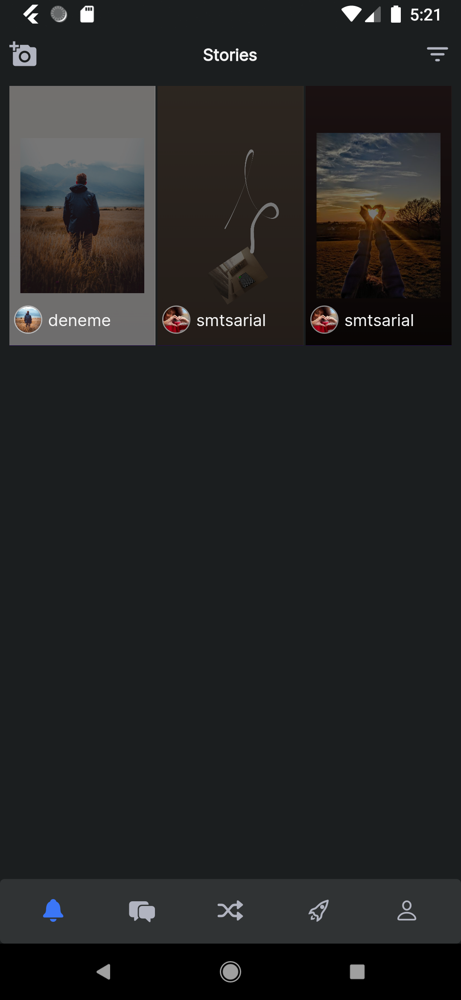
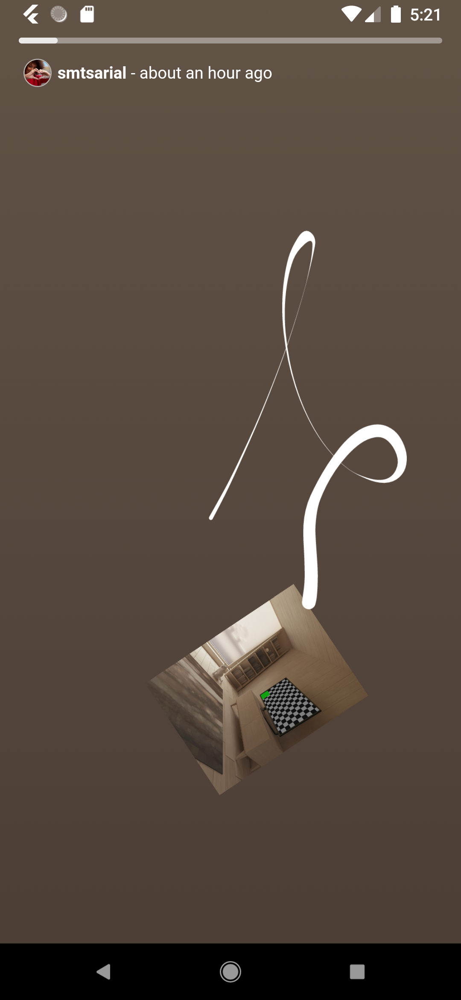
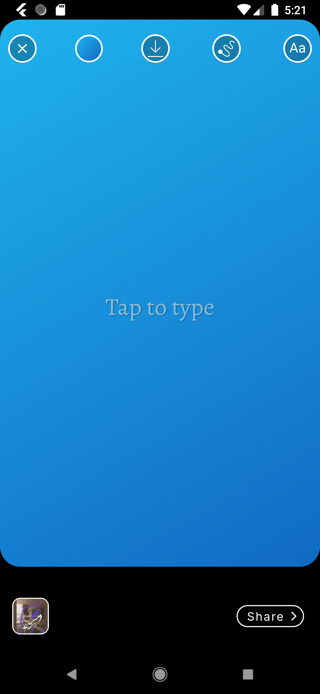
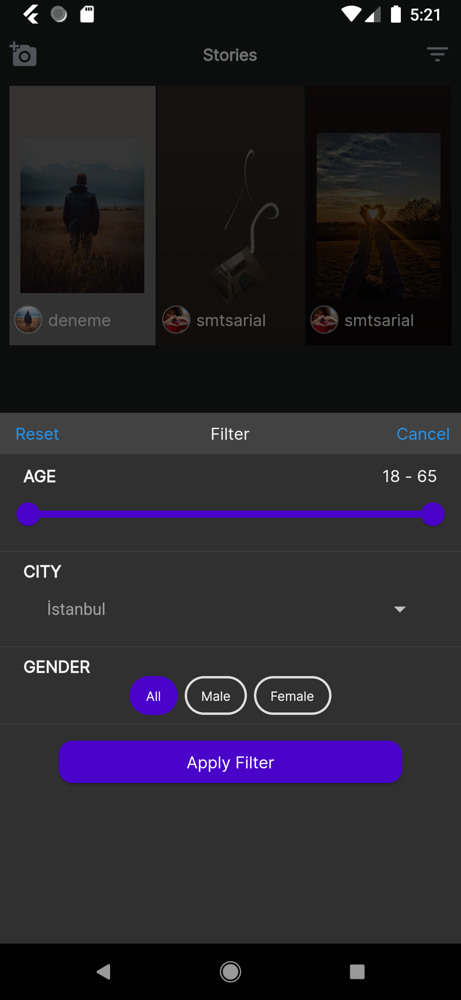
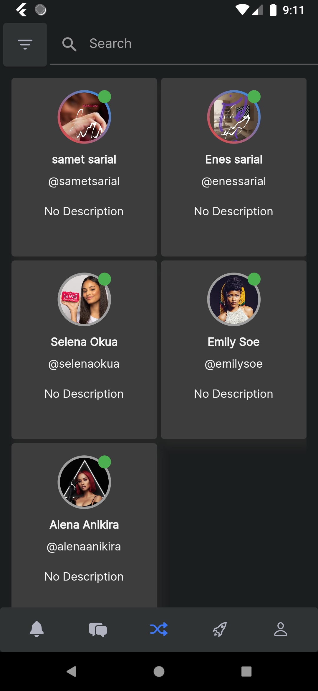
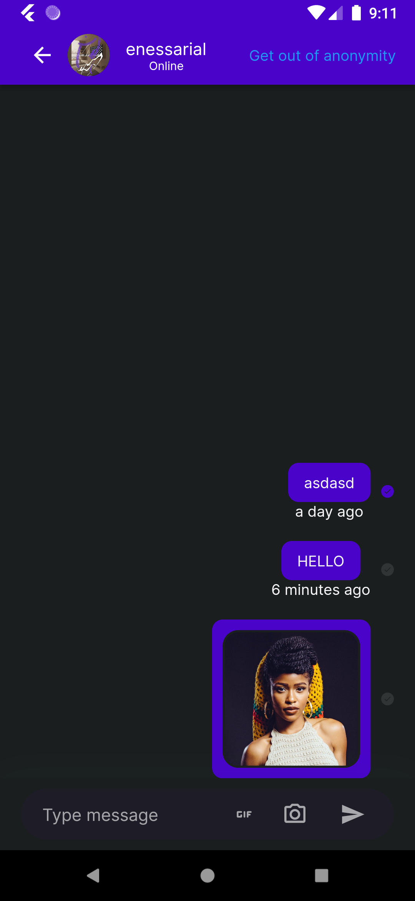
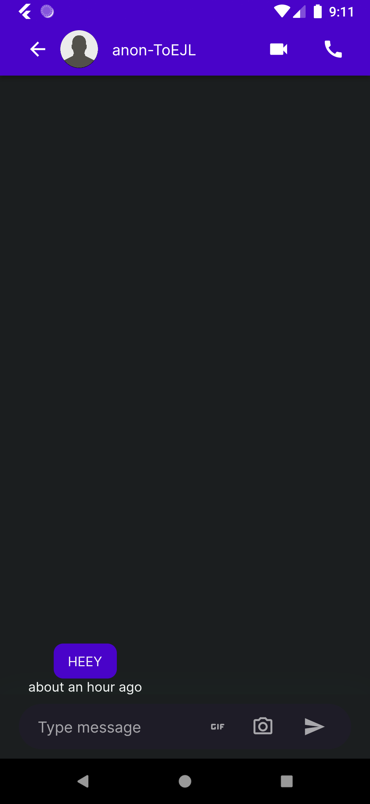
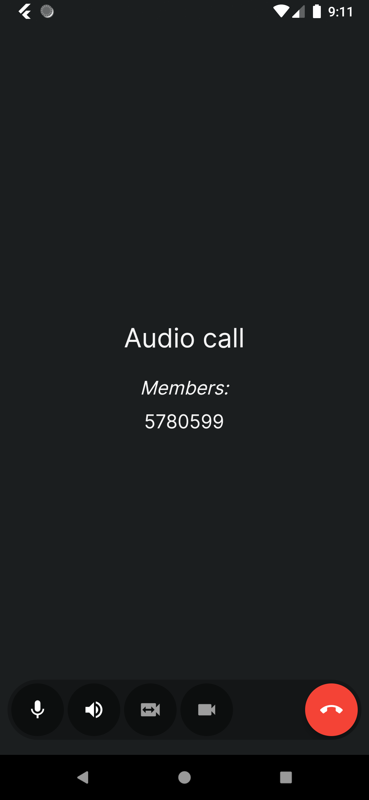

# anonmy

An anonymous chat and social app built with Flutter and Firebase. People meet without revealing who they are, chat with text, voice and media, share stories, and call each other.

## Features

- **Sign-in**: email/password and Google, on Firebase Auth
- **Chat rooms** on Cloud Firestore with text, photos, voice messages, reactions and swipe-to-reply
- **Voice and video calls** through ConnectyCube, with CallKit-style incoming call screens
- **Stories**: a built-in editor with text, fonts, text animations, gradients, freehand drawing, Giphy stickers and draggable items; export as image, GIF or MP4 (FFmpeg)
- **Profiles** that show interests instead of identity: hobbies, favourite movies (TMDB), Spotify tracks, YouTube videos and a voice intro
- **Push and local notifications** with Firebase Cloud Messaging; deep links with Firebase Dynamic Links
- **Monetisation**: in-app purchases and AdMob ads
- English and Turkish localisation (`lib/l10n`)

## Stack

- Flutter (Dart ≥ 2.16), Provider for state
- Firebase: Auth, Firestore, Realtime Database, Storage, Messaging, Dynamic Links
- ConnectyCube SDK for calls
- `ffmpeg_kit_flutter`, `perfect_freehand`, `story_view` for the story editor

## Project structure

```
lib/
  connections/   Firebase auth and Firestore access, ads, dynamic links, local notifications
  managers/      Call and push notification managers
  models/        User, chat message, story
  providers/     User and message room state
  screens/       auth (login, register, Google) and main (landing, home, profile, purchase, story editor)
  widgets/       Shared UI: audio chat, call kit, search bar, avatars
```

## Run locally

```bash
flutter pub get
flutter run
```

Add your own Firebase config (`google-services.json` for Android, `GoogleService-Info.plist` for iOS) and ConnectyCube credentials before running.

## Screenshots

<p>
  
  
  
  
</p>
<p>
  
  
  
  
</p>
